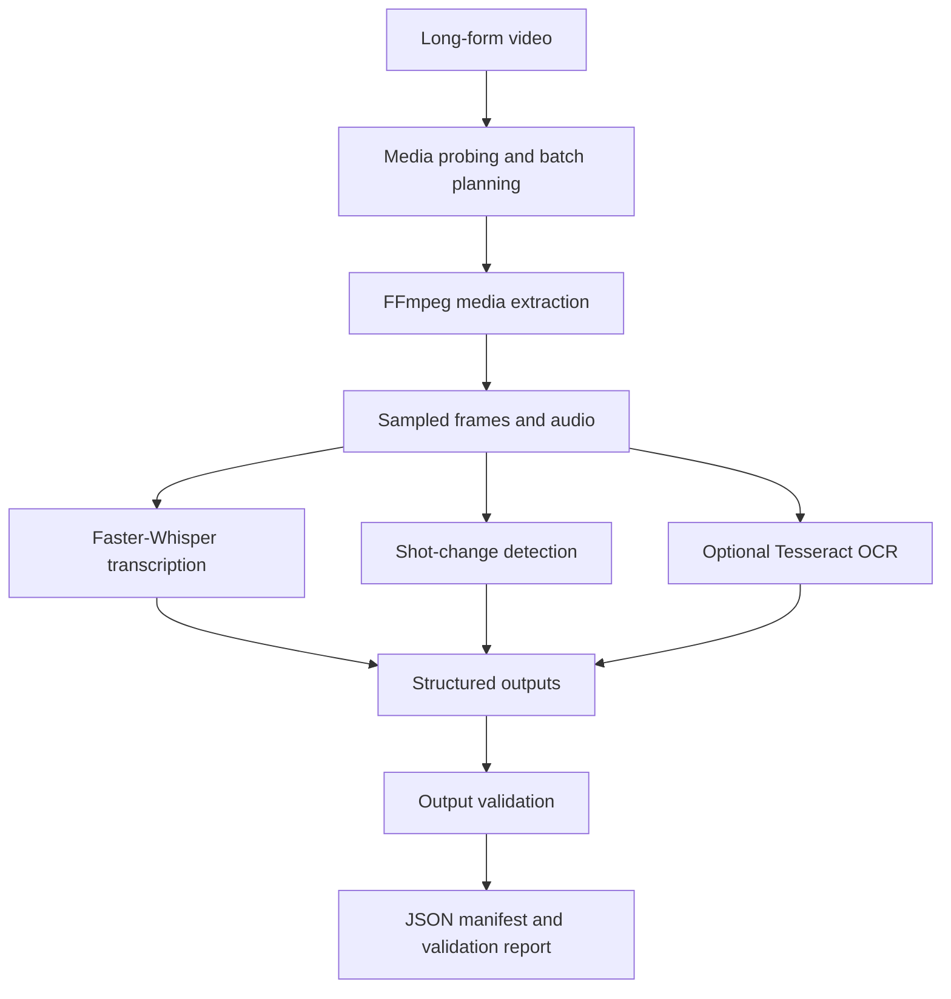

# Forklore Architecture

## Current implementation

## Future direction

The current pipeline provides the foundation for future narrative-understanding
components connecting characters, events, scenes, and relationships across movies.
Contextual question-answering and interactive story exploration are longer-term
goals, not claims about the current implementation.
